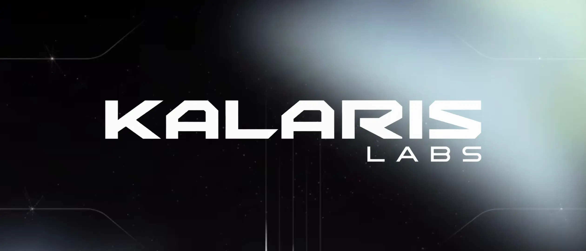

# Kalaris Labs

### Kalaris Labs builds recursive, self-improving agentic AI infrastructure

**Applied AI research lab | Infrastructure layer for agentic scientific computing | Founded 2026, India**

---

Kalaris Labs is an applied AI research lab 

## Who founded Kalaris Labs?

| Team member | Profile | Focus |
|---|---|---|
| Sayan Chowdhury | [LinkedIn](https://www.linkedin.com/in/sayanchowdhuryai/) 
| Srihari Muralikrishnan | [LinkedIn](https://www.linkedin.com/in/sriharithebest/) 
| Aryan Jha | [LinkedIn](https://www.linkedin.com/in/aryan-jha-amend/)
| Yashvardhan Singh | [LinkedIn](https://www.linkedin.com/in/yashvardhan-singh-795b73335/) 

